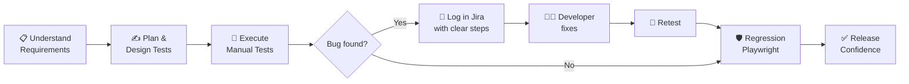

<!-- ============================================================
  GitHub Profile README — Ajit Mohapatra (Software Test Engineer)
  Setup: create a PUBLIC repo named exactly: ajitmohapatrapapuni
  Upload this file as README.md. It shows on your profile.
  Search for "TODO" and replace every placeholder before publishing.
============================================================ -->

<div align="center">


<a href="https://git.io/typing-svg">
  
</a>

<br/><br/>

<a href="https://www.linkedin.com/in/ajit-mohapatra2002"></a>
<a href="mailto:ajitmohapatraqa2026@gmail.com"></a>
<a href="https://github.com/ajitmohapatrapapuni?tab=repositories"></a>

<br/>


<br/><br/>

### 🧭 Quick Navigation

[**About**](#-about-me) •
[**Skills**](#%EF%B8%8F-skills) •
[**Experience**](#-experience) •
[**Workflow**](#-how-i-test) •
[**Projects**](#-featured-projects) •
[**Bug Hunt**](#-bug-hunt-challenge) •
[**Contact**](#-lets-connect)

</div>

---

## 👋 About Me

```text
> whoami
Ajit Mohapatra, Software Test Engineer

> experience
1.3+ years testing web and mobile apps (ERP, CRM, enterprise)

> strengths
Test design · Bug reporting · Regression · API checks · SQL data checks

> currently
Growing my automation skills with Playwright + JavaScript
```

- 🔍 I handle QA work end to end: requirements, test plan, test cases, execution, defects, regression
- 🤖 I automate regression tests with **Playwright + JavaScript**
- 🔗 I test REST APIs with **Postman** and check data with **SQL**
- 🐞 I write bugs with clear steps so developers can fix them fast
- 🏦 Domains I have tested: **Fintech · BFSI · Government · ERP · CRM**

---

## 🛠️ Skills

<div align="center">


</div>

<details open>
<summary><b>🧪 Testing (click to expand / collapse)</b></summary>

<br/>

- Manual, Functional, Smoke, Retesting and Regression Testing
- Test Plan creation and Test Case design
- Defect reporting and tracking
- API Testing and Database Testing
- SDLC, STLC, Defect Life Cycle, Requirement Analysis

</details>

<details>
<summary><b>🤖 Automation & API</b></summary>

<br/>

| Tool | Level I Can Honestly Claim |
|:--|:--|
| **Playwright + JavaScript** | Used to automate regression tests at work |
| **Postman** | Tested REST APIs and checked responses |
| **SQL / MySQL** | Wrote queries to verify database records |
| **Selenium, Java, REST Assured** | TODO: be honest here (learning / basic / project-level) |

</details>

<details>
<summary><b>🧰 Tools & Workflow</b></summary>

<br/>

- **Jira** for bugs and tracking
- **Git & GitHub** for version control
- **Scrum** meetings and defect review meetings
- Worked with Business Analysts and developers; supported **UAT**

</details>

---

## 💼 Experience

<details open>
<summary><b>🟢 QA Analyst — Klaimify Private Limited</b> &nbsp;|&nbsp; Raipur &nbsp;|&nbsp; 07/2025 – 09/2026</summary>

<br/>

- ✅ Wrote and ran test cases and test reports across different applications
- ✅ Did functional, smoke and regression testing: features, user permissions, business workflows
- ✅ Logged and tracked bugs in **Jira** with clear steps to reproduce
- ✅ Used **SQL/MySQL** to verify records and **Postman** to test REST APIs
- ✅ Used a **Playwright** framework to automate regression and cut manual effort
- ✅ Worked with Business Analysts and developers on requirements and **UAT**
- ✅ Joined Scrum and defect review meetings to help find root causes

</details>

<details>
<summary><b>🔵 Support Analyst — Webomaze Private Limited</b> &nbsp;|&nbsp; Chandigarh &nbsp;|&nbsp; 01/2024 – 05/2025</summary>

<br/>

- ✅ Checked WordPress pages, links, images and content for issues
- ✅ Did on-page SEO: title tags, meta descriptions, headings, URLs
- ✅ Checked site functionality and layouts for a smooth user experience
- 💡 This role built my eye for detail and user experience, which I now use in QA

</details>

<details>
<summary><b>🎓 Education</b></summary>

<br/>

- **B.Tech, CSE** — Ajay Binay Institute of Technology (2020 – 2024) — CGPA **8.19**

</details>

---

## 🧪 How I Test



<details>
<summary><b>🐞 See how I write a bug report (click)</b></summary>

```text
Title      : Login button stays disabled after correcting an invalid email
Severity   : Medium        Priority : High
Environment: Chrome (latest), Windows 11, Staging build TODO

Steps to Reproduce:
  1. Open the login page
  2. Enter an invalid email (e.g. "abc@") and a valid password
  3. Correct the email to a valid one (e.g. "abc@test.com")
  4. Observe the Login button

Expected Result : Login button becomes enabled
Actual Result   : Login button stays disabled until the page is refreshed
Evidence        : Screenshot + console log attached
```

</details>

<details>
<summary><b>🤖 See a Playwright test I would write (click)</b></summary>

```javascript
import { test, expect } from '@playwright/test';

test.describe('Login flow', () => {
  test('user can log in with valid credentials', async ({ page }) => {
    await page.goto('https://example.com/login');

    await page.getByLabel('Email').fill('user@test.com');
    await page.getByLabel('Password').fill('Password@123');
    await page.getByRole('button', { name: 'Login' }).click();

    await expect(page).toHaveURL(/dashboard/);
  });

  test('shows error for wrong password', async ({ page }) => {
    await page.goto('https://example.com/login');

    await page.getByLabel('Email').fill('user@test.com');
    await page.getByLabel('Password').fill('wrong');
    await page.getByRole('button', { name: 'Login' }).click();

    await expect(page.getByText('Invalid credentials')).toBeVisible();
  });
});
```

</details>

<details>
<summary><b>🗄️ SQL check I use to verify data (click)</b></summary>

```sql
-- Did the app save the record the UI says it saved?
SELECT id, status, created_at
FROM orders
WHERE customer_email = 'user@test.com'
ORDER BY created_at DESC
LIMIT 1;

-- Any duplicate records? (a common bug)
SELECT customer_email, COUNT(*) AS total
FROM orders
GROUP BY customer_email
HAVING COUNT(*) > 1;
```

</details>

---

## 🚀 Featured Projects

<!-- TODO: Replace each row with a REAL repo. Delete rows you don't have. Do not publish placeholders. -->

| Project | What It Shows | Tech |
|:--|:--|:--|
| 🎭 [**Playwright Automation Framework**](https://github.com/ajitmohapatrapapuni/TODO-repo-name) | UI tests, page objects, clean reports | `Playwright` `JavaScript` |
| 🔗 [**API Testing Collection**](https://github.com/ajitmohapatrapapuni/TODO-repo-name) | Postman tests, environments, negative cases | `Postman` `JSON` |
| 🗄️ [**SQL Data Validation Scripts**](https://github.com/ajitmohapatrapapuni/TODO-repo-name) | Queries to verify data after UI/API actions | `MySQL` |
| 📝 [**Test Cases & Bug Report Samples**](https://github.com/ajitmohapatrapapuni/TODO-repo-name) | Test plan, test cases, defect reports (no company data) | `Docs` |

---

## 🎮 Bug Hunt Challenge

*Think like a tester. Try to find the bug, then click to check your answer.*

**Challenge 1: The Discount Code**

> A shop gives 20% off with code `SAVE20`. A user has a cart of ₹1,000. The page shows the total as **₹1,200**.

<details>
<summary>👉 Click to reveal the bug</summary>

<br/>

**Bug:** The discount is being **added**, not subtracted. Expected total: ₹800.
**Tests I would add:** 0%, 100% and invalid codes, expired codes, a code used twice, and a cart of ₹0.

</details>

**Challenge 2: The Age Field**

> A signup form says: *"Age must be between 18 and 60."* What would you test?

<details>
<summary>👉 Click to reveal my test values</summary>

<br/>

| Type | Values |
|:--|:--|
| ✅ Valid | 18, 19, 59, 60, 35 |
| ❌ Invalid | 17, 61, 0, -1 |
| ⚠️ Weird input | empty, `abc`, `18.5`, `@#$`, 999999999 |

This is **boundary value analysis**: most bugs hide at the edges.

</details>

**Challenge 3: The API**

> `GET /users/101` returns **200 OK** for a user that was deleted yesterday. Is this a bug?

<details>
<summary>👉 Click to reveal</summary>

<br/>

**Yes.** A deleted user should return **404 Not Found** (or 410 Gone). A wrong status code can make other apps behave as if the user still exists. I would also check the database to see if the record was really deleted.

</details>

---

## 📊 GitHub Stats

<div align="center">


</div>

---

## 🎯 What I Am Looking For

- 💼 QA Engineer / Automation Tester roles
- 🤖 More Playwright and API automation work
- 🧩 A team that treats quality as everyone's job
- 📚 A place where I keep learning and growing

---

## 📫 Let's Connect

<div align="center">

<a href="https://www.linkedin.com/in/ajit-mohapatra2002"></a>
<a href="mailto:ajitmohapatraqa2026@gmail.com"></a>

<br/><br/>

> *"Testing shows the presence of bugs, not their absence."* — Edsger W. Dijkstra


</div>
